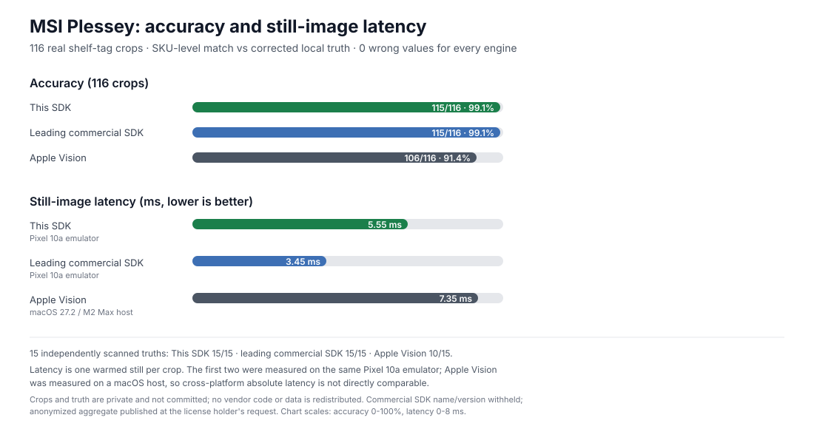

# Benchmarks and evaluation

This page records what has actually been measured, how it was measured, and
what the numbers do **not** cover. It exists so performance claims can be
checked instead of taken on trust.

## Summary

- **152/162 exact reads** on real grocery shelf tags at near range under the
  shelf-tag policy (`MOD_10_10`); 146/162 far, 152/162 from stills.
- **0 wrong reads** at fixed 9-digit bounds, 0 false reads on the 14
  must-not-misread negatives, and **0 false reads across 3,430 clutter
  frames**.
- **129–133/162 reads at ±6°/±10° tilt**, with 0 wrong reads.
- **170/170 host-harness assertions green** (189/189 with the local fixture photos); native decode averages
  **0.49 ms** per 1280×720 synthetic frame (Apple M2 Max, Nov 2026; was
  0.74 ms before the digit-template vectorisation).

## Comparison



Same 116 real shelf-tag crops, same truth set, one still per crop. All three
engines had **zero wrong values**; the misses differ. Still-image latency
per crop (mean / p50 / p95; image-file load and UI excluded).

| Engine | Platform | 116-crop SKU match | 15 strict truths | Mean | p50 | p95 |
|---|---|---:|---:|---:|---:|---:|
| This SDK | Pixel 10a emulator | 115/116 · 99.1% | 15/15 | 4.68 ms | 4 ms | 12 ms |
| Leading commercial SDK (vendor withheld) | Pixel 10a emulator | 115/116 · 99.1% | 15/15 | 3.45 ms | 3 ms | 5 ms |
| Apple Vision | macOS 27.2 / M2 Max host | 106/116 · 91.4% | 10/15 | 7.35 ms | 7.15 ms | 10.76 ms |

The 116 crops are hand-isolated single-tag crops from the local 110-photo
shelf set, not the 162-tag near/far/still sweep and not a held-out set.
"SKU match" compares the 7-digit printed item; "strict truths" are full 9-digit
codewords independently scanned for 15 tags. This SDK ran `MOD_10_10` with
9-digit bounds; the commercial engine used the equivalent double-Mod10,
9-digit configuration. Measured 2026-10-31: this SDK at commit `b1a8fd1`
(includes the digit-template vectorisation; the same-protocol run at
`ed7d039` measured 5.55 ms / 4 ms / 14 ms), commercial and Vision rows as
first measured. This comparison predates the still-path fallbacks: the fast
path is unchanged, but the one miss in that run would now pay fallback
latency; see [`MSI_PERFORMANCE.md`](MSI_PERFORMANCE.md).

Timed region: this SDK's `scanBitmap` (native prepare + MSI decode), the
commercial engine's `BitmapFrameSource` -> `BarcodeCapture` path, and Apple
Vision's `VNDetectBarcodesRequest`; all three excluded image-file load/UI.
Apple Vision ran on macOS, so its absolute latency is not directly
comparable to the Pixel emulator numbers. This is still-image decoding, not
a live-camera comparison. The commercial result is an anonymized aggregate
published at the license holder's request; vendor name/version and raw rows
remain private.

## Reproducible host harness

```sh
cd tools/msi-harness
./build.sh && ./msi_harness
```

The harness has no Android or device dependency. It renders vectors from the
MSI spec (not from the decoder's own tables), covers all four checksum
policies and the 9-digit shelf format, sweeps blur/scale/rotation and
clutter negatives, and exercises the native frame path.

Latest run (2026-11-22, macOS 27.2, Apple M2 Max):

| Check | Result |
|---|---|
| Assertions | 151 pass, 0 fail (170 with the six local fixture photos) |
| Bench: 1280×720 synthetic MSI | 486 µs mean, 494 µs worst |
| Bench: real shelf photo | 524 µs mean, 631 µs worst |
| 1280×720 text-clutter negatives | 0 false positives (30 frames) |
| Clutter sweep | 0 false reads (3,430 frames) |

Timings are machine-dependent; the assertion count and false-positive checks
are the stable gates.

## Real shelf-photo regression

Data set: 110 user-supplied HEIC photos, 176 tags, ground truth from the
printed item line plus the tag format (7-digit item + Mod10 + Mod10 =
9-digit `MOD_10_10` codeword). 162 tags are scored; the other 14 are
must-not-misread negatives (13 cut by the photo edge, one unreadable even by
a commercial scanner). Photos are private and never committed; methodology
and per-build history are in
[`MSI_PLESSEY_RESEARCH.md`](MSI_PLESSEY_RESEARCH.md) §10.

| Input mode | Exact reads | Wrong reads |
|---|---|---|
| Near aim-box crops | 152/162 | 0 |
| Far aim-box crops | 146/162 | 0 |
| Still path | 152/162 | 0 |
| Full photos, open lengths | 92/110 photos | 0 |

Tilted tags (scored crops rotated in software, `MOD_10_10`, 9-digit bounds):

| Rotation | −10° | −6° | +6° | +10° |
|---|---|---|---|---|
| Exact reads | 129/162 | 133/162 | 131/162 | 129/162 |
| Wrong reads | 0 | 0 | 0 | 0 |

For reference, the original 141-crop tilt set read 4/81/62/4 before the skew
retry.

Checksum-less `NONE` is debug-only and is not the shelf-tag policy; it has two
known far-field wrong reads on 8-digit fragments. The production policies
(`MOD_10`, `MOD_10_10`) have zero wrong reads at 9-digit bounds.


## Latency

| Path | Measurement |
|---|---|
| Native MSI decode, host | 0.49 ms mean / 0.56 ms worst per 1280×720 synthetic frame |
| Native MSI decode, real shelf photo | ~0.55 ms mean / 0.71 ms worst (host, harness bench) |
| MSI still path, 116 real crops (Pixel 10a emulator, warmed) | 4.7 ms mean / 4 ms p50 / 12 ms p95 after the digit-template vectorisation (5.5 ms before, local private run) |
| MSI still fallback stack, all-failure frame (host) | 412 ms mean / 596 ms p95 / 743 ms max |
| MSI still fallback, 16 MP all-failure still (host) | 59 ms / 34 MB peak (4 MP heavy-fallback cap) |
| MSI still fallback, 550×550 noise (host) | 299 ms / 7 MB peak |
| MSI still fallback, 400×400 noise (ensemble, host) | 640 ms / 22 MB peak |
| MSI still fallback, 1000×1000 noise (host) | 352 ms / 21 MB peak |
| MSI still fallback, 1870×1870 (3.5 MP angle, host) | 740 ms / 68 MB peak |
| MSI still fallback, 1871×1871 (over angle cap, host) | 150 ms / 31 MB peak |
| MSI still fallback, 2048×1536 (3.1 MP, host) | 687 ms / 56 MB peak |
| MSI still fallback, 2000×2000 (4 MP, host) | 156 ms / 35 MB peak |
| 9-digit clutter frame, host | 9.3 ms mean / 31.6 ms p95 / 70.2 ms max |
| On-device full chain, one-shot | ~15–60 ms typical (Pixel 6a / emulator) |

The on-device full-chain figures are end-to-end and device-dependent; the
host figures isolate the native MSI decoder. The 116-crop still row is a
local private run (the crops are not committed), not reproducible from a
clean clone.

A faster still path is possible by skipping or cheapening the 180-degree
confirmation (about 1.7 ms mean in a local A/B experiment), but it returns
wrong checksum-valid values
on blurred upside-down tags (`891801110`, `900800087`). The harness now pins
those cases, so full reverse-view retries are required; the reported 4.7 ms
keeps the confirmation intact.

## Scope boundaries

- **The commercial comparison is anonymized and evaluation-only.** A licensed
  commercial barcode SDK was run on finished builds over the same 116 crops
  and device, but the repository contains no commercial SDK dependency,
  license key or per-row comparison data. The vendor name/version and raw
  rows stay private; only the aggregate table and chart are published. No
  commercial SDK code, weights, model outputs, or per-read data are used in
  the decoder, its tests, or training.
- **The real-photo set is private.** A clean clone reproduces the synthetic
  and frame-path results, not the 110-photo table. The real-photo numbers
  come from the local regression described in the research note; the
  accuracy table predates the still-path rotation/sharpening/multi-scale
  fallbacks (the augmented-suite comparison is in
  [`MSI_ANGLE_MODEL.md`](MSI_ANGLE_MODEL.md)).
- **Fallback timing is host-only.** The rotation, sharpened and 2x/3x
  retries are still-path only and run only after a miss. Host all-failure
  negatives measure 412 ms mean / 596 ms p95; device latency and thermal
  behavior are not yet measured. Live frames never run these retries. The
  heavy stack is capped at a 4 MP source, so full-resolution 12–16 MP stills
  use the normal orientation sweep only. The accuracy numbers use the exact
  9-digit shelf configuration; default open-length stills get the angle
  fallback only.
- **Open-length defaults are not the accuracy gate.** The 0-wrong and
  2,286-positive figures use the exact 9-digit shelf configuration. Default
  open-length MOD10 stills get the direction-safe angle fallback but not the
  sharpened/scale retries; pre-existing open-length negative behavior is
  outside this table.
- **Not a camera benchmark.** There are no fps, thermal, battery or
  time-to-first-scan measurements here.
- **Apple Vision is a host baseline.** It was measured on macOS stills, not
  on the Pixel emulator; its absolute latency is not directly comparable.
