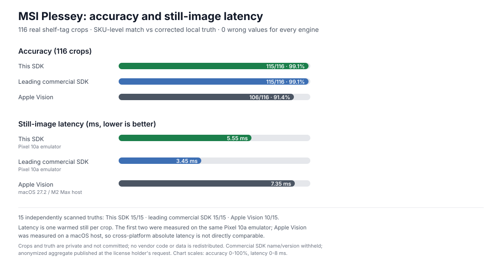

# Benchmarks and evaluation

This page records what has actually been measured, how it was measured, and
what the numbers do **not** cover. It exists so performance claims can be
checked instead of taken on trust.

## Summary

- **152/162 exact reads** on real grocery shelf tags at near range under the
  shelf-tag policy (`MOD_10_10`); 146/162 far, 152/162 from stills.
- **0 wrong reads** at fixed 9-digit bounds, 0 false reads on the 14
  must-not-misread negatives, and **0 false reads across 3,430 clutter
  frames**.
- **129–133/162 reads at ±6°/±10° tilt**, with 0 wrong reads.
- **133/133 host-harness assertions green** (152/152 with the local fixture photos); native decode averages
  **0.74 ms** per 1280×720 synthetic frame (Apple M2 Max, Oct 2026).

## Comparison



Same 116 real shelf-tag crops, same truth set, one still per crop. All three
engines had **zero wrong values**; the misses differ. Still-image latency
per crop (mean / p50 / p95; image-file load and UI excluded).

| Engine | Platform | 116-crop SKU match | 15 strict truths | Mean | p50 | p95 |
|---|---|---:|---:|---:|---:|---:|
| This SDK | Pixel 10a emulator | 115/116 · 99.1% | 15/15 | 5.55 ms | 4 ms | 14 ms |
| Leading commercial SDK (vendor withheld) | Pixel 10a emulator | 115/116 · 99.1% | 15/15 | 3.45 ms | 3 ms | 5 ms |
| Apple Vision | macOS 27.2 / M2 Max host | 106/116 · 91.4% | 10/15 | 7.35 ms | 7.15 ms | 10.76 ms |

The 116 crops are hand-isolated single-tag crops from the local 110-photo
shelf set, not the 162-tag near/far/still sweep and not a held-out set. "SKU
match" compares the 7-digit printed item; "strict truths" are full 9-digit
codewords independently scanned for 15 tags. This SDK ran `MOD_10_10` with
9-digit bounds; the commercial engine used the equivalent double-Mod10,
9-digit configuration. Measured 2026-10-31 at SDK commit `ed7d039`.

Timed region: this SDK's `scanBitmap` (native prepare + MSI decode), the
commercial engine's `BitmapFrameSource` -> `BarcodeCapture` path, and Apple
Vision's `VNDetectBarcodesRequest`; all three excluded image-file load/UI.
Apple Vision ran on macOS, so its absolute latency is not directly
comparable to the Pixel emulator numbers. This is still-image decoding, not
a live-camera comparison. The commercial result is an anonymized aggregate
published at the license holder's request; vendor name/version and raw rows
remain private.

## Reproducible host harness

```sh
cd tools/msi-harness
./build.sh && ./msi_harness
```

The harness has no Android or device dependency. It renders vectors from the
MSI spec (not from the decoder's own tables), covers all four checksum
policies and the 9-digit shelf format, sweeps blur/scale/rotation and
clutter negatives, and exercises the native frame path.

Latest run (2026-10-31, macOS 27.2, Apple M2 Max):

| Check | Result |
|---|---|
| Assertions | 133 pass, 0 fail (152 with the six local fixture photos) |
| Bench: 1280×720 synthetic MSI | 742 µs mean, 756 µs worst (20 iterations) |
| 1280×720 text-clutter negatives | 0 false positives (30 frames) |
| Clutter sweep | 0 false reads (3,430 frames) |

Timings are machine-dependent; the assertion count and false-positive checks
are the stable gates.

## Real shelf-photo regression

Data set: 110 user-supplied HEIC photos, 176 tags, ground truth from the
printed item line plus the tag format (7-digit item + Mod10 + Mod10 =
9-digit `MOD_10_10` codeword). 162 tags are scored; the other 14 are
must-not-misread negatives (13 cut by the photo edge, one unreadable even by
a commercial scanner). Photos are private and never committed; methodology
and per-build history are in
[`MSI_PLESSEY_RESEARCH.md`](MSI_PLESSEY_RESEARCH.md) §10.

| Input mode | Exact reads | Wrong reads |
|---|---|---|
| Near aim-box crops | 152/162 | 0 |
| Far aim-box crops | 146/162 | 0 |
| Still path | 152/162 | 0 |
| Full photos, open lengths | 92/110 photos | 0 |

Tilted tags (scored crops rotated in software, `MOD_10_10`, 9-digit bounds):

| Rotation | −10° | −6° | +6° | +10° |
|---|---|---|---|---|
| Exact reads | 129/162 | 133/162 | 131/162 | 129/162 |
| Wrong reads | 0 | 0 | 0 | 0 |

For reference, the original 141-crop tilt set read 4/81/62/4 before the skew
retry.

Checksum-less `NONE` is debug-only and is not the shelf-tag policy; it has two
known far-field wrong reads on 8-digit fragments. The production policies
(`MOD_10`, `MOD_10_10`) have zero wrong reads at 9-digit bounds.


## Latency

| Path | Measurement |
|---|---|
| Native MSI decode, host | 0.74 ms mean / 0.76 ms worst per 1280×720 synthetic frame |
| Native MSI decode, real shelf photo | ~0.7–1 ms (host, README bench) |
| MSI still path, 116 real crops (Pixel 10a emulator, warmed) | 5.5 ms mean / 4 ms p50 / 14 ms p95 (local private run) |
| 9-digit clutter frame, host | 9.3 ms mean / 31.6 ms p95 / 70.2 ms max |
| On-device full chain, one-shot | ~15–60 ms typical (Pixel 6a / emulator) |

The on-device full-chain figures are end-to-end and device-dependent; the
host figures isolate the native MSI decoder. The 116-crop still row is a
local private run (the crops are not committed), not reproducible from a
clean clone.

A faster still path is possible by skipping or cheapening the 180-degree
confirmation (about 1.7 ms mean in a local A/B experiment), but it returns
wrong checksum-valid values
on blurred upside-down tags (`891801110`, `900800087`). The harness now pins
those cases, so full reverse-view retries are required; the reported 5.5 ms
keeps the confirmation intact.

## Scope boundaries

- **The commercial comparison is anonymized.** A licensed commercial barcode
  SDK was run on the same 116 crops and device, but the repository contains
  no commercial SDK dependency, license key or per-row comparison data.
  The vendor name/version and raw rows stay private; only the aggregate
  table and chart are published.
- **The real-photo set is private.** A clean clone reproduces the synthetic
  and frame-path results, not the 110-photo table. The real-photo numbers
  come from the local regression described in the research note.
- **Not a camera benchmark.** There are no fps, thermal, battery or
  time-to-first-scan measurements here.
- **Apple Vision is a host baseline.** It was measured on macOS stills, not
  on the Pixel emulator; its absolute latency is not directly comparable.
